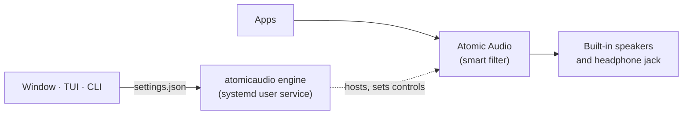
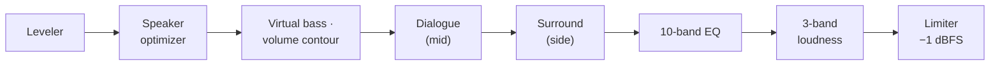

<p align="center">
  
</p>

<h1 align="center">Atomic Audio</h1>

<p align="center"><strong>Full, wide, loud sound from laptop speakers on Linux.</strong></p>


Laptop speakers are tiny, and played as they are they sound thin and boxy.
Atomic Audio is the processing that makes them sound full, wide and loud: a
PipeWire filter in front of your built-in speakers, with a window, a terminal
UI and a command line to control it.

- **Modes** for what you're playing: Dynamic, Movie, Music, Game, Voice, and
  Custom, which keeps your own mix.
- **Speaker optimizer**: a correction curve measured for your laptop's
  speakers, with a gentle generic curve for laptops that haven't been
  measured yet.
- **Bass enhancer** rebuilds bass the speakers physically can't play, as
  harmonics they can. Your ear fills in the missing low note.
- **Surround virtualizer** makes the sound wider than the laptop on
  speakers, and moves it out of your head on headphones.
- **Dialogue enhancer**, **volume leveler** and a **three-band loudness**
  stage that makes things louder without pumping or distortion.
- **Volume-aware**: at low volume it gives back the bass and treble that
  hearing loses, so quiet listening doesn't sound thin.
- **Ten-band equalizer** drawn over a live spectrum of what you hear, with
  its own gentle presets (Flat, Open, Rich, Focused), a custom curve, and a
  library of 21 more from open-source players under **More**: tone fixes
  (Bass Boost, Treble Boost, Vocal Clarity, Podcast, Loudness Curve) and
  genres from Ballad and Classical to Rock, Techno and Deep House.
- **Separate speaker and headphone settings**, switched automatically when
  you plug in.
- **One-key compare** with the original sound.

Every app goes through it, the volume keys keep working, and turning it off
leaves the system exactly as it was.

## Why your laptop sounds thin on Linux

Often the drivers are fine, and what's missing is the processing. On the ASUS
ROG Zephyrus G14 (2024), where Atomic Audio was built, all four speakers play
under Linux. The two Cirrus CS35L56 amps load ASUS's firmware and split the
sound between woofers and tweeters themselves. Measured with the laptop's own
microphone:

| Problem | What you hear | What Atomic Audio does |
| --- | --- | --- |
| The amps cut everything below ~95 Hz | No bass at all | Turns the missing bass into harmonics the speakers can play |
| The woofer cavity resonates at 630 Hz (+12 dB) | "Boxy", honky sound | Cuts exactly that resonance |
| Dip at the woofer/tweeter handover (~2.5 kHz) | Voices slightly veiled | Fills it in a little |

The same measurement with Atomic Audio on (Dynamic mode): the 630 Hz peak is
5 dB lower, and the bass of 50–100 Hz notes comes through 10–20 dB louder.

## Requirements

- Linux with **PipeWire** and **WirePlumber 0.5 or newer** (for smart
  filters; check with `wireplumber --version`)
- `pactl` (from libpulse / pulseaudio-utils) and `systemd` user services
- Qt 6.5+ to build (qt6-base, qt6-declarative), and qt6-svg to show the icon

## Install

From a clone of this repository, **without root**, into `~/.local`:

```sh
bin/install-local
atomicaudio on
```

**As an Arch package**, which installs into `/usr`:

```sh
bin/install          # builds the package and asks for your sudo password
atomicaudio on
```

`atomicaudio on` starts the engine now and at every login. Then open
**Atomic Audio** from your launcher, or run `atomicaudio tui` in a terminal.

## Use it

### The window

Pick a mode, adjust an effect, or drag the points on the equalizer. The
spectrum shows what the speakers play. When the engine is on, a thin line
also shows what apps sent in, before processing.

| Key | Does |
| --- | --- |
| Space | Turn Atomic Audio on or off |
| A | Compare with the original sound |
| 1 – 6 | Dynamic, Movie, Music, Game, Voice, Custom |
| E | Next equalizer preset |
| ↑ ↓ / K J | Pick an effect |
| ← → | Turn the effect down or up |
| O | Speaker optimizer on or off |
| H | Edit the speakers' or the headphones' sound |
| R | Reset this output to its defaults |
| Ctrl+Z / Ctrl+Shift+Z | Undo / redo |
| ? | All shortcuts |
| Q | Quit (the sound stays on) |

On the equalizer, double-click a point to reset it, or scroll over it for
half-decibel steps.

### The terminal

```
  ATOMIC AUDIO   ● on   output: speakers   editing: speakers

  1 dynamic  2 movie  3 music  4 game  5 voice  6 custom

    Surround   ██████████████████████████░░░░░░  80%
    Dialogue   ██████████████████░░░░░░░░░░░░░░  55%
  > Bass       █████████████████████░░░░░░░░░░░  65%
    Leveler    ████████████████░░░░░░░░░░░░░░░░  50%
    Loudness   ██████████████████░░░░░░░░░░░░░░  55%
    Optimizer  on

  EQ: rich
   ███  ███  ███
  ──────────────────────────────────────────────────
   31   62  125  250  500   1k   2k   4k   8k  16k
```

`atomicaudio tui` has the same controls: arrows to move and adjust (`j`/`k`
move too), `1`–`6` for modes, `e` for presets, `a` to compare, `h` to switch
between speakers and headphones, `space` for on/off, `u`/`r` to undo and
redo, and `q` to quit. On the EQ row, `tab` or `,` `.` pick a band.

### The command line

For scripts, keybindings and agents:

```sh
atomicaudio status [--json]          # engine, output, mode, effects
atomicaudio on | off
atomicaudio mode movie               # dynamic, movie, music, game, voice, custom
atomicaudio set bass 70              # surround, dialogue, bass, leveler, loudness: 0-100
atomicaudio set tuning off           # the speaker optimizer
atomicaudio set speakers generic     # optimizer curve: auto, generic, rog-g14-2024
atomicaudio eq rich                  # flat, open, rich, focused, custom
atomicaudio eq list                  # every preset, the library's too (rock, deep-house, ...)
atomicaudio eq 2 3 2 0 0 0 0 1 1 1   # or ten gains in dB, 31 Hz … 16 kHz
atomicaudio bypass                   # toggle the original sound
atomicaudio reset
```

Add `--speakers` or `--headphones` to change that output's sound. Without
either, the output playing now is changed. Every command exits 0 on success
and 1 with an error on stderr.

A Hyprland keybinding that flips between the enhanced and the original
sound (instantly, since the filter stays loaded):

```
bind = SUPER ALT, A, exec, atomicaudio bypass
```

## Supported laptops

Atomic Audio works on any laptop whose built-in speakers show up in PipeWire
as a sink with a speaker port, which covers almost all of them.

| Laptop | Speaker optimizer |
| --- | --- |
| ASUS ROG Zephyrus G14 (2024, GA403) | Measured curve |
| Everything else | Gentle generic curve, safe on any speakers |

The model is detected automatically from DMI; override it with
`atomicaudio set speakers <curve>`.

### Add your laptop

A measured curve makes the biggest difference, and measuring takes about
a minute:

1. Turn Atomic Audio off (`atomicaudio off`), set the volume to about 50%,
   and keep the room quiet.
2. Run `tools/measure-speakers`. It plays short tones and records them with
   the internal microphone, three times.
3. Look for where the response falls off at the low end (that's the
   high-pass), any narrow peak more than 6 dB above its neighbours (a
   resonance to cut), and any broad dip (to fill a little, never more than
   about 3 dB).
4. Add an entry to `dsp/profiles.h` with your laptop's DMI product name
   (`cat /sys/class/dmi/id/product_name`). Raise the `Profile` range in
   `dsp/params.h` to match, then open a pull request with the measurement
   output.

Laptop microphones aren't flat and sit in odd places, so correct only what
is clearly there. Half of what the measurement shows is plenty.

## How it works



- The DSP is a LADSPA plugin in `dsp/`: plain C++ with no allocation in the
  audio thread.
- `atomicaudio engine` hosts it in PipeWire's filter-chain as a WirePlumber
  smart filter targeting the built-in speakers. WirePlumber routes the
  speakers' streams through it, and the default device stays the same.
- The engine applies setting changes live through `pw-cli`. It follows the
  headphone jack and the volume through `pactl subscribe`, and restarts the
  filter if it ever stops.
- The window, the TUI and the CLI only edit
  `~/.config/atomicaudio/settings.json`; the engine picks changes up within
  milliseconds.

The signal chain, in order:



| Stage | How |
| --- | --- |
| Leveler | K-weighted loudness of both channels steers a slow gain; it rises over seconds and catches sudden loud scenes in 40 ms |
| Speaker optimizer | 4th-order high-pass plus five peaking/shelf filters per laptop |
| Virtual bass | Everything under 120 Hz is normalized by a peak-hold envelope and run through Chebyshev polynomials for clean 2nd–4th harmonics, kept to 100–480 Hz |
| Volume contour | Bass and treble shelves that grow as the output volume drops below −10 dB (ISO 226), scaled by the bass amount |
| Dialogue | Presence boost and low-mid cut on the mid (center) signal only |
| Surround | Side signal widened above 300 Hz, decorrelated ambience, and crosstalk cancellation on speakers or crossfeed on headphones |
| Loudness | Linkwitz-Riley split at 200 Hz and 3 kHz, a soft-knee compressor per band, phase-matched so the bands sum flat |
| Limiter | 2 ms lookahead, hold-min plus box filter, with a 4× oversampled true-peak detector so peaks between samples are caught too |

## Performance and safety

- **CPU**: about 1.7% of one core.
- **Latency**: 2.1 ms, the limiter's lookahead plus 5 samples for the
  true-peak interpolator.
- **Transparent when flat**: with every effect at zero, the output is within
  0.05 dB of the input from 30 Hz to 18 kHz. Bypass is bit-exact.
- **Never clips**: the limiter holds peaks at −1 dBFS whatever the settings,
  checked with full-scale noise and every effect at maximum. It limits the
  reconstructed waveform, not just the samples: a 12 kHz tone sampled
  between its crests stays under −0.9 dBTP, where sample-peak limiting let
  it reach +1.85 dBTP.
- **No pumping**: with the three-band loudness stage, a bass hit no longer
  pushes voices down. Measured: 0.0 dB of ducking, where a single-band stage
  ducks voices by 5.9 dB.
- **Hands off your hardware**: it never changes mixer controls, card
  profiles or the default device. Turning it off removes the filter
  completely.

## Troubleshooting

**Nothing changes when I turn it on.** Check the window for a yellow banner,
or run `atomicaudio status`. Atomic Audio processes only the built-in
speakers and headphone jack. Sound going to Bluetooth, HDMI or USB passes
through untouched.

**It says "Starting…" for a long time.** Look at the engine's log:
`journalctl --user -u atomicaudio -e`.

**It's too much.** Pick Music mode, or turn down Surround and Loudness. Press
**A** to hear the original for comparison.

**My settings file is broken.** The app keeps it as
`settings.json.broken`, starts with defaults, and tells you so.

## Uninstall

```sh
atomicaudio off
# Installed with bin/install-local:
rm ~/.local/bin/atomicaudio ~/.local/lib/ladspa/atomicaudio.so \
   ~/.local/share/applications/atomicaudio.desktop \
   ~/.local/share/icons/hicolor/scalable/apps/atomicaudio.svg \
   ~/.config/systemd/user/atomicaudio.service
# Installed as a package:
sudo pacman -R atomicaudio
# Either way, your settings:
rm -r ~/.config/atomicaudio
```

## Develop

```sh
bin/build                  # build/atomicaudio and build/dsp/atomicaudio.so
bin/test                   # DSP, settings, engine plumbing, UI state, theme, language
build/atomicaudio          # run without installing
```

A development build that isn't installed writes its own user service when
you turn it on, pointing at itself. Installing replaces it.

| Path | What |
| --- | --- |
| `dsp/` | The signal chain (`processor.cpp`), laptop curves (`profiles.h`), LADSPA glue |
| `src/engine.cpp` | The background service |
| `src/backend.cpp` | State shared by the window and the TUI |
| `src/cli.cpp` | Command line and terminal UI |
| `src/*.qml` | The window |
| `tools/measure-speakers` | Speaker measurement with the built-in microphone |

## License

MIT, see [LICENSE](LICENSE).

The library equalizer presets are taken, as published, from
[iQualize](https://github.com/dariuscorvus/iqualize) (Copyright © 2026
Darius, MIT License; the tone curves and the electronic and rap genres) and
from GStreamer's 10-band equalizer presets
([GstIirEqualizer10Bands.prs](https://gitlab.freedesktop.org/gstreamer/gstreamer/-/blob/main/subprojects/gst-plugins-good/gst/equalizer/GstIirEqualizer10Bands.prs),
LGPL-2.1-or-later; the other genres).
